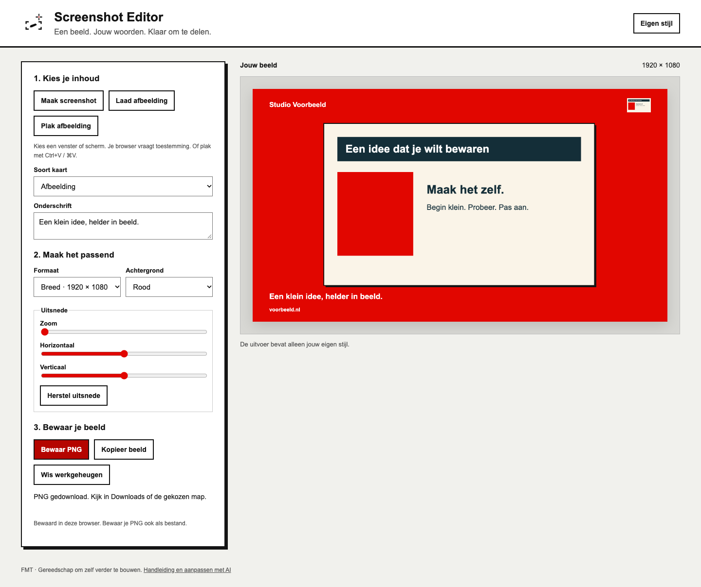

# FMT Screenshot Editor

Maak van een screenshot een helder beeld met je eigen woorden en stijl. Of maak een tekstkaart zonder afbeelding. Voor **Mac, Windows en Linux**, lokaal in Chrome of Edge, zonder account, abonnement of AI-sleutel.

Ik maakte dit met AI omdat ik het zelf nodig had. Ik ben geen programmeur en geen designer. Gebruik het zoals het is, of neem het als vertrekpunt voor jouw eigen versie.

## Beginnen

1. Download [het nieuwste bronpakket](https://github.com/erwinblom/screenshot-editor/releases/latest), pak de ZIP helemaal uit en houd de bestanden bij elkaar.
2. Open **index.html** in Chrome of Edge. Afbeeldingen laden, tekstkaarten maken en PNG downloaden werken zonder installatie en zonder internet.
3. Kies **Laad afbeelding**, schrijf een onderschrift en kies een formaat. Met **Bewaar PNG** komt je beeld in Downloads of in de map die je browser vraagt.

Wil je de schermkiezer en het werkgeheugen op een vast lokaal adres gebruiken? Start dan via de meegeleverde launcher. Je hebt hiervoor [Python 3](https://www.python.org/downloads/) (3.9 of nieuwer) nodig; er worden geen Python-pakketten geïnstalleerd.

| Computer | Starten vanuit de uitgepakte map |
|---|---|
| Windows | Dubbelklik **Start Screenshot.bat**. |
| Mac | Open Terminal in de map en voer `sh "Start Screenshot.command"` uit. |
| Linux | Open een terminal in de map en voer `sh "Start Screenshot.sh"` uit. |

Je browser opent **http://127.0.0.1:48763**. Open dat adres in Chrome of Edge als je standaardbrowser anders is. Laat het terminalvenster open tijdens gebruik; sluit het om te stoppen. Volgende keer gebruik je dezelfde starter en hetzelfde browserprofiel. De app is alleen op je eigen computer bereikbaar. De starter opent geen internetdienst.

## Wat kun je ermee?

- **Screenshot maken:** kies in het browservenster een tabblad, venster of scherm en bevestig delen. De app neemt één beeld en stopt de opname meteen. Geluid wordt niet opgenomen.
- **Afbeelding gebruiken:** laad PNG, JPG of WebP (tot 25 MB), of plak een gekopieerde afbeelding met Ctrl+V / ⌘V. De knop Plak afbeelding vraagt zo nodig klembordtoestemming.
- **Tekstkaart maken:** kies Citaat / slogan en schrijf maximaal 500 tekens.
- **Vormgeven:** vierkant (1080 × 1080), breed (1920 × 1080) of staand (1080 × 1920); wit, zwart of rood; onderschrift; zoom en positie van je afbeelding.
- **Eigen stijl:** voeg optioneel naam, logo en website toe. Kies Bewaar stijl. Annuleren behoudt de vorige stijl. Leeg de velden en kies Geen logo om weer merkloos te exporteren.
- **Bewaren:** download een PNG of kopieer het beeld naar je klembord. De PNG bevat jouw opmaak; geen verplicht FMT-logo.

De schermkiezer verschilt per systeem en browser. Op de Mac kan macOS extra schermopnametoestemming vragen. Op Linux bepalen de desktop en X11/Wayland mede welke schermen of vensters beschikbaar zijn. Deze browserversie heeft geen systeemwijde sneltoets; gebruik de knop. Een bestaande screenshot laden blijft altijd een bruikbare route. De oorspronkelijke native Mac-bron blijft in Sources/ beschikbaar; zie [de aanvullende handleiding](LEESMIJ.md).

## Waar blijft mijn werk?

Wacht op de melding **Bewaard in deze browser** voordat je sluit. De laatste afbeelding, tekst en stijl worden lokaal bewaard in het browserprofiel (IndexedDB). Er is geen upload, telemetrie of account. De app laadt geen externe scripts of fonts. Met **Wis werkgeheugen** verwijder je de bewaarde invoer en stijl; je gedownloade PNG's blijven bestaan.

Werkgeheugen is geen back-up. Wissen van browsergegevens of een privévenster kan je werk verwijderen. Bij direct openen van index.html kunnen browserregels of het verplaatsen van de map het werkgeheugen beïnvloeden. Gebruik de starter en hetzelfde browserprofiel voor een vaste plek. Wisselen tussen index.html en het lokale adres opent verschillende werkgeheugens.

## Zo pas je Screenshot Editor aan

Je kunt AI in gewone taal vragen om de software aan jouw werk aan te passen. Bijvoorbeeld: een extra beeldformaat, andere bedieningskleuren of een knop voor jouw vaste onderschrift.

1. Bewaar het originele ZIP-bestand. Maak een aparte uitgepakte kopie voor je eigen versie.
2. Open die kopie in een AI-programmeeromgeving, of geef een nieuwe ChatGPT- of Claude-chat de complete ZIP. Stuur geen persoonlijke screenshots mee.
3. Vraag eerst één kleine wijziging. Gebruik bijvoorbeeld deze opdracht:

> Dit is de complete broncode van Screenshot Editor. Ik ben geen programmeur. Lees de handleiding en bestanden. Maak alleen de rode bedieningsknoppen blauw (#2563EB); behoud de kleuren van de PNG-uitvoer en het appicoon. Werk in mijn projectkopie. Behoud bestaande functies, mijn gegevens en licenties. Help me de gewijzigde versie op mijn computer te openen. Test afbeelding laden, tekstkaart, PNG bewaren en heropenen. Vertel wat je echt hebt gecontroleerd. Publiceer of verstuur niets.

4. Een gewone chat verandert je lokale bestanden niet vanzelf. Vraag om een compleet aangepast project als download, pak dat in een nieuwe map uit en open index.html. Werkt de download niet? Vraag voor een kleine wijziging om de bestandsnaam en exact welke tekst je vervangt.
5. Controleer zelf de wijziging én een normale export. Bewaar de werkende versie voordat je een volgende wens toevoegt.

De browserinterface staat in index.html en web/style.css; gedrag en beeldopmaak in web/app.js. Voor gebruik is geen Node.js nodig. Ontwikkelaars kunnen met Node.js 22, `npm ci` en `npm test` de browsercontroles draaien; Chrome en Python moeten geïnstalleerd zijn. Maak voor een eigen localhostversie ook een andere poort en IndexedDB-naam als je gescheiden werkgeheugen wilt.

## Als iets niet werkt

- **Python ontbreekt:** gebruik index.html voor de basisfuncties, of installeer Python 3 voor de starter. Op Windows kan `py -3 start.py` helpen.
- **Poort 48763 is bezet:** sluit een eerder gestart Screenshot-terminalvenster. Start daarna opnieuw.
- **Scherm- of klembordtoegang geweigerd:** gebruik Laad afbeelding en Bewaar PNG. Geef alleen toestemming wanneer je die functie wilt gebruiken.
- **PNG-knop uitgeschakeld:** lees de melding; er ontbreekt een afbeelding/tekst of het onderschrift is te lang.
- **Fout na een eigen wijziging:** geef je AI de foutmelding en de gewijzigde bestanden, zonder privéscreenshots of wachtwoorden. Of open je oorspronkelijke kopie.

[Probleem melden](https://github.com/erwinblom/screenshot-editor/issues) · [Wat is getest](PUBLICATIESTATUS.md) · [MIT-code](LICENSE) · [FMT-merkvoorwaarden](MERKVOORWAARDEN.md)

Eigen aanpassingen hoef je niet terug te geven. Voor een aangepaste versie die je verspreidt, gebruik je een eigen naam en logo volgens de merkvoorwaarden. De code blijft vrij te hergebruiken onder MIT.
